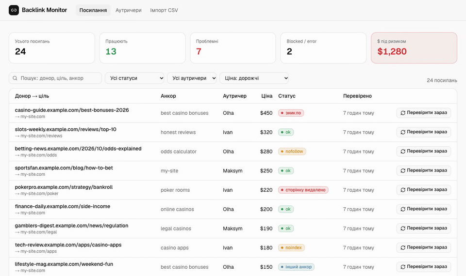
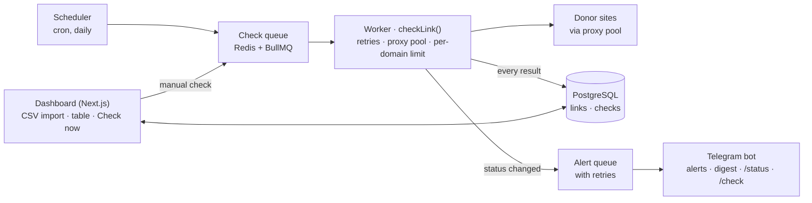

# Backlink Monitor

Checks purchased backlinks every day and tells the team in Telegram the moment a link disappears or stops passing SEO value.

SEO teams pay donor sites for links, and donors quietly remove them, add `nofollow`, or close the page from indexing. Nobody has time to re-check hundreds of links by hand, so the money is wasted silently. Backlink Monitor re-checks every link daily and alerts **only when a status actually changes**. It never mistakes a captcha, a 403 or a donor that is down for an hour for a lost link. Each alert names the outreacher who placed the link and what it cost, so they know whom to write to and what is at stake.



## Run locally in 3 commands

Requires Node 22.19+ and Docker.

```bash
npm install
npm run setup      # .env from .env.example, Postgres + Redis in Docker, migrations
npm run dev:all    # dashboard on http://localhost:3000 + worker
```

Then upload a CSV on **Імпорт CSV** (or `npm run import links.csv`), or fill the dashboard with demo data: `npm run seed:demo`.
For Telegram alerts, put `TELEGRAM_BOT_TOKEN` and `TELEGRAM_CHAT_ID` in `.env` and check them with `npm run tg:test`.

## Architecture

One repo, two processes. **web** (Next.js dashboard) and **worker** (queues + Telegram bot) talk only through Postgres and Redis.



An alert is produced only when the worker sees a status change. Everything else ends up in the check history and the daily digest.

| Part | Tech |
|---|---|
| Language | TypeScript, Node 22 |
| HTTP + parsing | undici (`ProxyAgent`) + cheerio |
| Queues, schedule | BullMQ 6 (Job Schedulers) + Redis |
| DB | PostgreSQL + Prisma 7 (driver adapter) |
| Validation | Zod 4 |
| Dashboard | Next.js 16 + Tailwind 4 + shadcn/ui |
| Bot | grammY |
| Tests | Vitest: HTML fixture per status, real local HTTP + proxy servers, integration tests on Postgres + Redis |

## What a check does

One `GET` of the donor page (max 5 redirects, 15 s timeout, 5 MB cap, HTML only), parsed with cheerio:

1. HTTP code and final URL after redirects.
2. An `<a href>` pointing at the target. URLs are normalized: http/https, `www.`, trailing slash, `utm_*`/`gclid`/`fbclid`, fragment and query-param order don't matter. Relative links and `<base href>` are resolved.
3. Link `rel`: `nofollow`, `sponsored`, `ugc`.
4. Anchor text versus the expected one (case and whitespace-insensitive, `` for image links).
5. `<meta name="robots">` and the `X-Robots-Tag` header (`noindex`, `nofollow`, `none`; only directives for all bots or Googlebot count).
6. `<link rel="canonical">` (tag or `Link` header) pointing at another page.

If several links on the page point at the target, the best one counts (dofollow first, then matching anchor).

## Statuses

One status per check, highest priority wins, plus an `issues[]` list with details.

| Status | When | Alert |
|---|---|---|
| `blocked` | 401/403/429/503 after all retries, or a captcha / Cloudflare challenge page | no, digest only |
| `error` | timeout, DNS, TLS, network after all retries | no, digest only |
| `page_gone` | 404 / 410 | yes, after 2 checks in a row |
| `lost` | page is 200 but the link is gone | yes, after 2 checks in a row |
| `nofollow` | link has `rel` nofollow/sponsored/ugc, or the page itself is `nofollow` | yes |
| `noindex` | page is `noindex` or its canonical points elsewhere | yes |
| `anchor_changed` | link alive, anchor text differs | yes, low priority |
| `ok` | all good | "recovered" alert if it was a problem before |

**Core rule:** `blocked` and `error` never count as a lost link. Alerts fire only when the *last conclusive* status changes, so `ok → error → ok` produces no alerts. A first `lost`/`page_gone` schedules a re-check one hour later, and the alert goes out only if that check confirms it.

**Money at risk** = the price of links that are `lost`, `page_gone`, `nofollow` or `noindex`.

## Failure modes

| What breaks | Without protection | How it is handled |
|---|---|---|
| Donor returns a captcha or 403 | False "link lost" alert | Status `blocked`, no alert. Challenge markers (`cf-chl`, `challenge-platform`, "Just a moment", `cf-mitigated`, Incapsula, DDoS-Guard) are recognized even on a 200. A reCAPTCHA in a contact form on a normal page is not mistaken for a wall. |
| Donor is down for an hour | Alert and panic in the team | 3 retries (2 s → 8 s → 30 s + jitter, `Retry-After` honoured), then the alert waits for a second check 1 h later |
| A proxy dies | Every check fails | Circuit breaker: 3 network failures in a row disable the proxy for 10 min, and every retry goes through a different proxy |
| All proxies are dead | Hundreds of `error`s a minute | Jobs are delayed (no fake `error` recorded), the queue is paused, one system alert is sent, work resumes when a proxy cools down. There is no fallback to our own IP. |
| 20 links on one domain | Donor bans our IP | Per-domain limit: Redis `SET NX PX` slot per domain. A busy domain moves the job to *delayed* instead of blocking a worker. Open-source BullMQ has no group rate limits; those are BullMQ Pro only. |
| Link rendered by JavaScript | `lost` although the link exists | Known limitation. Next step: Playwright fallback. |
| URLs in different formats (www, slash, utm) | `lost` although the link exists | URL normalization + unit tests |
| Worker crashes mid-run | Some links never checked | Jobs live in Redis (AOF). Delayed and waiting jobs survive, an active one is recovered as stalled and re-run. Verified with `kill -9`: nothing lost, no duplicates. |
| Cron fires twice | Duplicate jobs and alerts | `jobId = ${linkId}_${date}`, completed jobs kept 24 h. The alert is enqueued with `jobId = alert_${checkJobId}` before the DB write, so a crash in between can't duplicate it. |
| Telegram API unavailable | Alert lost | Alerts are their own queue with 10 retries and exponential backoff. Permanent 4xx errors (wrong chat id) are not retried forever. |
| 50 MB page or not HTML | Worker eats memory | Body cut at 5 MB + Content-Type check. A cut page without the link is `error`, not a false `lost`. |

## Telegram

- **Instant alert** on a status change: `❗ Посилання зникло: blog-example.com/best-tips → my-site.com. Аутричер: Olha. Заплачено: $150` + details + a link to the link card.
- **Daily digest** at 10:00 (`TZ`): ok / problems / blocked counts, money at risk, the most expensive problems, donors that couldn't be checked.
- **Commands**: `/status` (summary), `/check <donor url>` (check now and reply with the result).
- The bot answers only the configured chat.

## Dashboard

Stats row (total, ok, problems, blocked/error, **$ at risk**), a links table filtered by status and outreacher with search, sorting by price and a **Check now** button, a link card with the full check history (date, HTTP code, status, response time, proxy, details), an outreacher report (links, % alive, $ lost) and a CSV import page with a per-line error report. Optional single password: `DASHBOARD_PASSWORD`.

## CSV import

`donor_url` and `target_url` are required. `anchor`, `outreacher`, `price_usd` and `placed_at` (YYYY-MM-DD) are optional. The import is idempotent on `donor_url + target_url`: re-uploading a file updates rows instead of duplicating them. Invalid rows never fail the import; they go to an error report with their line number.

## Scripts

| Command | What it does |
|---|---|
| `npm run dev:all` | dashboard + worker with reload |
| `npm run worker` | worker only (queues, schedules, bot) |
| `npm run import links.csv` | CSV import from the terminal |
| `npm run run-now` | queue today's check for every link (safe to repeat) |
| `npm run check-now -- <donor url>` | same as the Check now button |
| `npm run check -- <donor> <target> [anchor]` | one-off check, prints the result, writes nothing |
| `npm run digest-now [-- --print]` | send (or print) today's digest |
| `npm run queue:status` | job counts per queue |
| `npm run tg:test` | verify the bot token and chat id |
| `npm run seed:demo` | replace all links with 24 fictional demo links |
| `npm test` | 146 tests: unit + integration (integration uses a separate DB and Redis DB 15 and is skipped if Docker is down) |

Every crawler number (concurrency, delays, timeouts, retries, proxy breaker) is in `.env`; see [.env.example](.env.example).

## Deploy

Railway: web + worker + Postgres + Redis in one project. Step-by-step guide: [docs/deploy-railway.md](docs/deploy-railway.md).

## How I built it with Claude Code

**Spec first.** I wrote the spec (problem, statuses, crawler limits, failure modes, a day plan with done criteria) before any code. It went into `CLAUDE.md`, which every session reads.

**Review before code.** Before writing anything, Claude Code checked the spec against the libraries and pushed back on seven points. I accepted them, and they live in `CLAUDE.md` as *amendments* that override the spec:
- The spec relied on BullMQ group rate limits, which exist only in the paid BullMQ Pro. It now uses its own Redis limiter.
- `:` is not allowed in custom job ids, so job ids use `_`.
- HTTP retries belong inside `checkLink()`, not BullMQ `attempts`, so that each retry uses another proxy and honours `Retry-After`.
- Page-level `nofollow` had no status.
- The digest needed a timezone.
- Render's free tier has no background workers.

**One step per commit, each step verified.** Eight steps, one commit each, tests with every step. Beyond unit tests, each step was checked against reality:
- Real sites: a Wikipedia link comes back as `nofollow`, and G2 and Crunchbase behind Cloudflare come back as `blocked`, not `lost`.
- A real undici `ProxyAgent` through a local proxy with authentication.
- `kill -9` of the worker mid-run.
- A live Telegram round-trip: the link is removed on a test page, the first check stays silent, and the alert arrives after the confirmation check.
- The dashboard, clicked through in a browser.

**Things caught along the way:**
- npm's `latest` tag for Prisma pointed at an 8.0 release candidate, so the version is pinned to 7.10.1.
- When all proxies died mid-check, an early `return` dropped the attempt count.
- On Railway's IPv6 private network, ioredis needs `family: 0`.
- A healthcheck behind the dashboard password would fail the deploy, so `/api/health` is excluded from the password.
- A reCAPTCHA in a contact form must not hide a real lost link.
- A page cut at 5 MB must not produce a false `lost`.

## Not in the MVP

Google index check (needs a paid SERP API), auth beyond one password, multi-tenancy, a JS-rendering fallback.
